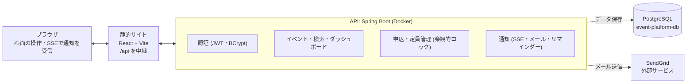

# Event Platform

勉強会・セミナーの作成と参加管理ができるイベント管理・予約プラットフォーム。主催者はイベントを作って参加者を管理でき、参加者は検索・申込・キャンセルができる。

- **認証・同時実行制御・タイムゾーン・外部メール連携**を含む実用的なWebアプリを、設計から公開まで通して作った
- 定員を超えない**同時申込の排他制御**(楽観的ロック)と、満席時の**キャンセル待ち自動繰上げ**
- 見る人のタイムゾーンで表示する**日時処理**(保存はUTC)
- SSEによる**リアルタイム通知**(SSEがつながらない環境では、30秒ごとの取り直しで補う)と、SendGridによる**メール通知**(参加確定・開始24時間前のリマインダー)
- バックエンドに19件の自動テストがあり、Render上で本番稼働している

## 目次
- [作成背景](#作成背景)
- [公開URL(Render)](#公開urlrender)
- [機能](#機能)
- [システム構成](#システム構成)
- [技術スタック](#技術スタック)
- [技術的ポイント](#技術的ポイント)
- [認証とリアルタイム通知の設計](#認証とリアルタイム通知の設計)
- [データモデル](#データモデル)
- [API一覧](#api一覧)
- [開発の進め方](#開発の進め方)
- [ローカル起動](#ローカル起動)
- [テスト](#テスト)
- [動作確認で見つけた不具合](#動作確認で見つけた不具合)
- [Renderへのデプロイ](#renderへのデプロイ)
- [既知の制約と今後の課題](#既知の制約と今後の課題)

## 作成背景
スクールの最終課題として作成した。題材は、勉強会やセミナーの作成と参加管理ができる「イベント管理・予約プラットフォーム」。

課題の要件は次のとおり。

- 機能: ユーザー登録・ログイン(JWT)、イベントCRUD+カテゴリ・タグ、参加申込・キャンセル・定員管理、イベント検索・フィルタ、リアルタイム通知(参加確定・リマインダー)、主催者ダッシュボード(参加者一覧・統計)、カレンダー表示、AWSまたはRenderへのデプロイ
- 技術的ポイント: 日時のタイムゾーン処理、同時申込の排他制御(楽観的ロック)、メール通知連携(SendGrid等)

これらを、設計から公開まで通して作ることを目的とした。デプロイ先はRender、メール送信はSendGridを選んだ。開発は、機能ごとにIssue・ブランチ・Pull Requestを分けて進めた。設計と動作確認の詳細は、提出資料(設計・報告書)にまとめている。このREADMEは、その要点をまとめたもの。

## 公開URL(Render)
- アプリ: https://event-platform-web-g55k.onrender.com
- APIヘルスチェック: https://event-platform-api-s0kk.onrender.com/actuator/health

> 無料枠のため、しばらくアクセスがないとサーバーがスリープします。初回の表示に1分ほどかかることがあります。

## 機能
課題で挙げた8機能と技術的ポイントは、すべて実装し、本番で動作している。メールの実送信(SendGrid)も、本番で参加確定メールとリマインダーメールの受信を確認した。

| 機能 | 内容 |
|---|---|
| ユーザー登録・ログイン(JWT) | BCryptでハッシュ化、JWT(有効期間24時間)、表示用タイムゾーンを登録 |
| イベントCRUD+カテゴリ・タグ | 作成・取得・更新・削除(更新・削除は主催者のみ)、初期カテゴリ4種、タグは自動登録 |
| 参加申込・キャンセル・定員管理 | 満席時はキャンセル待ち、キャンセルで先頭を自動繰上げ、楽観的ロックで同時申込を排他制御 |
| イベント検索・フィルタ | キーワード、カテゴリ、タグ(複数指定はAND)、期間、空きあり、ページング |
| リアルタイム通知 | SSEで参加確定・繰上げ・リマインダーを即時表示、通知一覧と既読。SSEがつながらない間は、30秒ごとに取り直す |
| メール通知(SendGrid) | 参加確定メール、開始24時間前のリマインダー。キー未設定時はログ出力 |
| 主催者ダッシュボード | 集計、イベント別の充足率、日別の申込推移、参加者一覧 |
| カレンダー表示 | 月表示、ユーザーのタイムゾーンの日付で表示 |
| Renderデプロイ | PostgreSQL・API(Docker)・画面(静的サイト)をBlueprintで一括作成 |

## システム構成
画面とAPIを分けた3層構成で、本番はRender上の3つのリソースで動かしている。ブラウザからの通信は静的サイトが受け、`/api`をAPIへ中継する。DBへの保存とSendGridへのメール送信は、APIだけが行う。画面とAPIを同じオリジンに見せることで、CORS設定を不要にした。



ライブラリは最小限にし、グラフとカレンダーは自前で描いている。

## 技術スタック

| 領域 | 技術 |
|---|---|
| バックエンド | Java 21 / Spring Boot 3.3 / Spring Security(JWT) / Spring Data JPA / Bean Validation / Actuator |
| データベース | PostgreSQL(本番) / H2 インメモリ(ローカル・テスト) |
| フロントエンド | React 18 / Vite 5 / React Router 6(ポート5173) |
| 通知 | SSE(Server-Sent Events) / SendGrid v3 API(APIキー未設定の場合はログ出力) |
| インフラ | Render(Blueprint) / Docker |

## 技術的ポイント
課題で挙げた3点(タイムゾーン、同時申込の排他制御、メール通知)は、いずれも自動テストで振る舞いを検証している。

### 1. 日時のタイムゾーン処理
**方針:** 保存はUTC、表示は見る人のタイムゾーン。

- DBには`Instant`(UTC)で保存する。APIの入力はオフセット付きISO 8601(例: `2026-12-15T19:00:00+09:00`)で受け、UTCに変換して保存する
- イベントは開催地のタイムゾーン(IANA形式)を持ち、レスポンスにはUTCの`startAt`と、開催地時間の`startLocal`を両方返す
- ユーザーも表示用タイムゾーンを持ち、画面・メール・通知・カレンダーの日付振り分けはユーザーのタイムゾーンで行う。開催地と違う場合は現地時間も併記する
- 作成フォームでは、開催地の壁時計の時刻をオフセット付きに変換する(夏時間の境界でオフセットを補正)。ダッシュボードの日別申込推移は、イベントのタイムゾーン基準で集計する

**検証:** 東京で19:00のイベントがUTCで10:00で保存されることをテストで確認。ニューヨーク設定のユーザーでは05:00、現地時間として19:00が併記されることを、本番の画面で確認した。

### 2. 同時申込の排他制御(楽観的ロック)
**方針:** 定員を超えないことを、イベント行のバージョン番号で保証する。

- `Event`に`@Version`と確定人数`confirmedCount`を持たせる。申込・キャンセルはイベントを`OPTIMISTIC_FORCE_INCREMENT`で取得し、必ずバージョンを進める。同時に別の処理が更新すると、後からコミットした方が`OptimisticLockingFailureException`となる
- 待ち列への追加だけではイベント行が変わらないため、同時のキャンセル(繰上げ)とすれ違う。それを防ぐ目的で、常にバージョンを進める方式を選んだ
- 競合した場合は、ファサードでランダムな待機を挟んで最大10回リトライし、尽きたら409を返す
- (イベント, ユーザー)のユニーク制約で二重申込を防ぎ、キャンセル後の再申込は同じ行を再利用して待ち列の末尾に入れる

**検証:** 定員5のイベントに30スレッドが同時に申込んだ結果、確定5・キャンセル待ち25・確定人数カウンター5となり、定員を超えなかった。このテストを3回連続で実行し、すべて成功した。

### 3. メール通知連携(SendGrid)
**方針:** メール送信の失敗を、申込処理に波及させない。

- 送信を`MailSender`というインターフェースに抽象化し、SendGrid v3 APIを呼ぶ実装と、ログに出すだけの開発用実装を用意した。`SENDGRID_API_KEY`が設定されると前者に切り替わる
- 参加確定メールは、トランザクションのコミット後に非同期で送る(`@TransactionalEventListener` + `@Async`)。送信が失敗しても申込は取り消されない
- リマインダーはスケジューラーが10分ごとに確認し、開始まで24時間以内の確定参加者に1回だけ送る。送信済み日時を申込ごとに記録して重複を防ぎ、失敗したものは次回再試行する
- メール本文の日時は、受信者のタイムゾーンで表示する

**検証:** 送信部分を差し替えたテストで、確定・繰上げのメールが送られること、リマインダーが1回だけ・範囲内のイベントに限って送られることを確認した。本番では、SendGridのAPIキーと認証済みの送信元を設定し、参加確定メールとリマインダーメールが実際に届くことを確認した。

## 認証とリアルタイム通知の設計
認証はステートレスなJWT、リアルタイム通知はSSE(Server-Sent Events)で実現した。

- **認証:** パスワードはBCryptでハッシュ化し、ログイン時にJWT(HMAC署名、有効期間24時間)を発行する。フィルターがリクエストごとに検証し、不正・期限切れは401を返す。フロントはトークンをブラウザに保存し、401を受けたら自動でログアウトする
- **SSEの認証:** ブラウザのEventSourceはAuthorizationヘッダを付けられない。JWTをURLに載せるとログに漏れるため、JWTで認証して**30秒有効・1回限りのticket**を発行し、ticketで接続する方式にした
- **配信:** 参加確定・繰上げ・リマインダーは通知としてDBに保存し、接続中のユーザーにその場でpushする。pushが失敗しても保存は残る
- **接続の維持:** 25秒ごとにハートビートを送り、プロキシによる切断を防ぐ。切断されたらフロントが待ち時間を延ばしながら再接続し、再接続時に一覧を取り直して取りこぼしを補う
- **制約:** 接続をサーバーのメモリで管理するため、1台構成が前提。複数台にするにはRedis等で配信を共有する必要がある
- **本番(Render)での動作:** 画面の経路(静的サイトの`/api/*`の中継)では、SSEの接続が開かず、リアルタイム配信は届かないことを、本番で確認した。APIに直接つなぐとSSEは正常に動く。そのため、画面は、SSEがつながっていない間(`live`が偽の間)、**30秒ごとに通知を取り直し**、タブが再び表示されたときと、通知パネルを開いたときにも取り直す。通知はDBに保存されているので、取りこぼしはない。パネルには、リアルタイムのときは「● リアルタイム」、そうでないときは「○ 30秒ごとに更新」と表示する

## データモデル
7つのテーブル(中間テーブルを含む)で構成し、スキーマはJPAの自動生成(`ddl-auto: update`)で管理している。

| テーブル | 主なカラム | 役割・制約 |
|---|---|---|
| `users` | id, email(ユニーク), passwordHash, displayName, timeZone | ユーザー。パスワードはBCrypt |
| `event` | id, organizerId, title, description, location, startAt, endAt(UTC), timeZone, capacity, confirmedCount, version, categoryId | イベント。`version`で楽観的ロック |
| `category` | id, name(ユニーク) | カテゴリ。初回起動時に4種を投入 |
| `tag` | id, name(ユニーク) | タグ。小文字にそろえて登録 |
| `event_tags` | event_id, tags_id | イベントとタグの多対多 |
| `registration` | id, eventId, userId, status, queueOrder, createdAt, reminderSentAt | 申込。(eventId, userId)のユニーク制約。statusはCONFIRMED / WAITLISTED / CANCELED |
| `notification` | id, userId, type, message, eventId, createdAt, readAt | アプリ内通知。未読は`readAt`が空 |

## API一覧
すべて`/api`以下。認証が必要なものは`Authorization: Bearer <JWT>`を付ける。エラーは適切なHTTPステータス(400・401・403・404・409)で返す。

| メソッドとパス | 認証 | 内容 |
|---|---|---|
| `POST /auth/register`, `/auth/login` | 不要 | 登録・ログイン。JWTとユーザー情報を返す |
| `GET /auth/me` | 必要 | ログイン中のユーザー |
| `GET /events` | 不要 | 一覧・検索(`q`, `categoryId`, `tag`, `from`, `to`, `availableOnly`, `organizerId`, `page`, `size`) |
| `GET /events/{id}` | 不要 | 詳細 |
| `POST /events` | 必要 | 作成 |
| `PUT`, `DELETE /events/{id}` | 必要(主催者のみ) | 更新・削除。他人は403 |
| `GET /categories`, `/tags` | 不要 | 一覧 |
| `POST /events/{id}/registrations` | 必要 | 参加申込(満席時はキャンセル待ち) |
| `DELETE /events/{id}/registrations` | 必要 | 申込キャンセル(先頭のキャンセル待ちを繰上げ) |
| `GET /events/{id}/registrations/me`, `/me/registrations` | 必要 | 自分の申込状況 |
| `GET /dashboard`, `/dashboard/events/{id}` | 必要(主催者のみ) | 集計、日別推移、参加者一覧 |
| `GET /notifications` | 必要 | 通知一覧と未読数 |
| `POST /notifications/{id}/read`, `/notifications/read-all` | 必要 | 既読にする |
| `POST /notifications/stream-ticket` | 必要 | SSE接続用の使い捨てticketを発行 |
| `GET /notifications/stream?ticket=` | ticket | SSE接続(リアルタイム通知) |

## 開発の進め方
開発は、1機能ごとにIssue・ブランチ・Pull Requestを切って進め、自動テストに加えて、実際のブラウザと本番環境でも確認した。

- 作業前にIssueを登録し、`issue-<番号>-<内容>`のブランチで作業する。`main`への直接コミット・プッシュはしない
- PRの本文に`Closes #番号`を書き、マージでIssueがクローズされる。マージは必ずユーザーの指示を待つ
- 機能デモとして登録したIssue 10件をすべて完了し、画面や不具合修正の追加Issueも同じ流れで進めた

詳しいルールは`CLAUDE.md`を参照(Issue→ブランチ→PR、mainへの直接pushは禁止)。

## ローカル起動
```bash
cd backend && mvn spring-boot:run     # http://localhost:8080 (H2インメモリ)
cd frontend && npm install && npm run dev   # http://localhost:5173 (/apiは8080へプロキシ)
```

バックエンドは8080、フロントエンドは5173で起動する。DBはH2(メモリ)を使う。本番と同じPostgreSQLでも、本番用設定(`prod`プロファイル)で起動と登録を確認した。

## テスト
```bash
cd backend && mvn test
```

バックエンドに19件の自動テストがあり、すべて成功している。

| 対象 | 件数 | 確認していること |
|---|---|---|
| 認証 | 2 | 登録・ログイン・me、二重登録(409)、不正な資格情報(401) |
| イベント | 2 | CRUD、主催者のみ編集可(403)、タイムゾーン変換、入力検証 |
| 検索 | 3 | キーワード(ワイルドカードのエスケープ)、タグAND、期間、空きあり |
| 申込・定員 | 2 | 30人の同時申込で定員超過なし、キャンセル待ちの繰上げ順 |
| メール通知 | 2 | 確認・繰上げメール、リマインダーの1回限り送信 |
| SSE通知 | 2 | ticketの1回限り利用、push、既読、他人の通知は404 |
| ダッシュボード | 1 | 集計、参加者一覧、主催者以外は403 |
| エラー応答 | 1 | 実サーバーで404・409が401に化けないこと |
| JWT秘密鍵の起動チェック | 4 | 本番(prod)で、開発用の既定値・32バイト未満だと起動に失敗する。強い値と、開発・テストでは起動できる |

## 動作確認で見つけた不具合
自動テストだけでは見つからなかった問題を、実際のブラウザと本番で、2つ見つけて修正した。

1. **エラー応答が401に化ける:** ログイン済みでも、404や409が`/error`への転送で認証必須に引っかかり、401になっていた(画面が勝手にログアウト)。MockMvcは転送を再現しないため、テストを通っていた。`/error`を許可し、実サーバーで確認する回帰テストを追加した
2. **別タブで別アカウントに切り替えると表示が食い違う:** ログイン情報はブラウザで共有されるので、開いたままのタブに主催者用ボタンが残り、操作すると403になった。権限エラーの文言表示と、タブ間のログイン同期を追加した

Renderの本番では、新規登録、ログイン、イベント作成・編集・削除、別アカウントによる申込、カレンダー表示、ダッシュボードを確認した。フロント経由の`/api`中継と、画面遷移の直アクセス(SPAのフォールバック)も正常。

## Renderへのデプロイ
`render.yaml`(Blueprint)でPostgreSQL・バックエンド(Docker)・フロント(静的サイト)を作成する。`main`へのマージで自動的に再デプロイされる。

| リソース | 種類 | 内容 |
|---|---|---|
| `event-platform-db` | PostgreSQL | データ保存。接続情報は環境変数としてAPIに自動注入 |
| `event-platform-api` | Web Service(Docker) | Spring Boot。マルチステージビルドでjarを作り、ヘルスチェックは`/actuator/health` |
| `event-platform-web` | Static Site | Reactをビルドして配信。`/api/*`をAPIへ中継し、それ以外は`index.html`を返す(SPA) |

1. Renderで **New → Blueprint** を選び、このGitHubリポジトリを接続する
2. 作成されるサービス名が`event-platform-api`/`event-platform-web`でない(名前重複で末尾に文字が付く)場合は、`render.yaml`の`destination`のバックエンドURLを実URLに直す
3. `event-platform-api`の環境変数を設定する。`JWT_SECRET`は自動生成、DB接続情報はDBから自動注入される。本番(`prod`プロファイル)では、`JWT_SECRET`が未設定(開発用の既定値のまま)や32バイト未満だと、起動に失敗する。次の値は、Blueprintの作成時に入力を求められず、一覧にも出ないため、**Environment**で手動で追加する(保存すると自動で再デプロイされる)
   - `SENDGRID_API_KEY` / `MAIL_FROM`: メールを実際に送る場合のみ。設定方法は次の「メールの設定」を参照
   - `CORS_ALLOWED_ORIGIN`: 任意。フロントが`/api`を中継するため、設定しなくても動く
4. デプロイ後、`https://<api>/actuator/health` が`UP`、フロントで登録→ログインできることを確認する

### メールの設定(SendGrid)
1. SendGridでアカウントを作り、**Settings → Sender Authentication** で **Single Sender** の送信元アドレスを認証する
2. **Settings → API Keys** で、**Restricted Access** のAPIキーを作る。権限は **Mail Send** のみでよい。キーは作成時に一度だけ表示される
3. Renderの`event-platform-api` → **Environment** で、`SENDGRID_API_KEY`(手順2のキー)と`MAIL_FROM`を追加して保存する。`MAIL_FROM`は、認証した送信元アドレスと**完全に同じ**にする(違うとSendGridが403で拒否する)
4. 新しいアカウントで、未来のイベントに申込み、参加確定のメールが届くことを確認する。リマインダーは、開始まで24時間以内のイベントに申込むと、最長10分ほどで届く

APIキーはリポジトリに書かず、Renderの画面だけで設定する。キーが未設定の場合、メールは送られず、ログに出力されるだけ。

## 既知の制約と今後の課題
課題の要件は満たしているが、運用を考えると次の制約がある。優先順は上から。

| 制約 | 影響 | 対応案 |
|---|---|---|
| 無料枠のスリープ | 初回表示が約50秒遅い。スリープ中はリマインダーも動かない | 外部監視(UptimeRobot)から5分ごとに`/actuator/health`へアクセスして起こしている(設定済み。APIの応答が0.2〜0.4秒で、眠っていない状態を確認) |
| 無料のPostgreSQLには期限がある | 期限後はデータが使えなくなる可能性 | Renderの現行の無料枠の条件を確認し、必要なら有料プランへ |
| 本番ではSSEのリアルタイム配信が届かない | Renderの静的サイトの`/api/*`の中継が、SSEを流さない(APIに直接つなぐと動く)。通知の反映が、最大30秒遅れる | 現状は、画面が30秒ごとに通知を取り直して補っている。根本的には、画面からAPIへ直接つなぐ(CORSの設定が必要)か、中継を使わない構成にする |
| SSEは1台構成が前提 | スケールアウトすると別サーバーのユーザーに届かない | Redis等のメッセージブローカーで配信を共有 |
| スキーマを`ddl-auto: update`で管理 | 変更履歴が残らず、列の削除・型変更は自動でできない | Flyway等のマイグレーションに置き換える |
| メール本文をログに出す(開発用実装) | SendGrid設定済みのため、本番ではログ実装は使われない | キー未設定の環境(ローカル等)でのみ使われる。その際はログにメールアドレスが残る点に注意 |
| パスワードリセット・メール認証なし | 登録時にメールアドレスの実在を確認していない | メール認証とパスワード再設定の機能を追加 |
